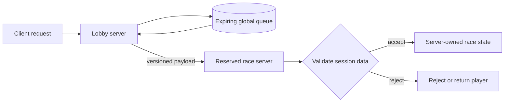

# Don't Drop the Egg! — Egg Race

An independent multiplayer racing game built in Roblox, with a focus on
server-authoritative systems, physical character reactions, cross-place
matchmaking, and repeatable validation.

This repository is both the main development history and the engineering
portfolio for the project. If you are reviewing the work, start with the three
modules below and then read the architecture notes.

## Portfolio review path

1. [`MatchProtocol.luau`](src/ReplicatedStorage/EggRaceMatchmaking/MatchProtocol.luau)
   validates untrusted cross-place session data.
2. [`CameraFit.luau`](src/ReplicatedStorage/EggRaceMath/CameraFit.luau)
   computes a responsive 3D ceremony camera from scene bounds and UI limits.
3. [`EggSlipController.client.luau`](src/StarterPlayerScripts/EggSlipController.client.luau)
   coordinates the player's slip, fall, recovery, and basket-retrieval states.

The [architecture notes](docs/ARCHITECTURE.md) explain the trust boundaries and
the [validation record](docs/VALIDATION.md) separates completed checks from
claims that still require verification.

## Engineering highlights

### Server-authoritative multiplayer flow

- Solo and Online intent originates on the client, while match identity,
  expected players, session state, start slots, and results remain server-owned.
- Cross-place payloads use a strict schema with duplicate-user, count, type,
  mode, capacity, and version checks.
- Live activation is separated from Studio dry-run behavior so the control flow
  can be exercised without issuing a real teleport.



### Physical reactions and recovery

The race controller treats slipping as a sequence of cancellable states rather
than a single animation. It tracks entry speed, fall direction, control locks,
recovery ownership, dropped-basket search, and safe movement restoration. The
server retains authority over race outcomes while the client owns presentation
and responsive local motion.

### Responsive 3D presentation

The ceremony camera does not depend on one hand-tuned coordinate. It collects
visible stage and participant bounds, projects their corners into a camera
basis, and solves the minimum distance that fits the scene while reserving
screen space for the results UI.

### Reproducible asset tooling

The `tools/` directory records Python-based Blender build, diagnostic, render,
and export steps for the woven basket. Intermediate files remain visible in the
history so visual changes can be traced rather than represented as a single
opaque final asset.

## Repository map

| Path | Purpose |
| --- | --- |
| `src/ServerScriptService/` | Server-owned basket, egg, and race behavior. |
| `src/StarterPlayerScripts/` | Player movement, slip recovery, VFX, and diagnostics. |
| `src/ReplicatedStorage/EggRaceMatchmaking/` | Typed contract, admission checks, and narrow client API. |
| `src/ReplicatedStorage/EggRaceMath/` | Reusable 3D camera-fitting math. |
| `assets/basket/` | Basket source assets and visual diagnostics. |
| `tools/` | Python/Blender build and inspection scripts. |
| `tests/` | Focused protocol rejection cases. |
| `docs/` | Architecture and validation evidence. |

## Example: validating a session payload

```luau
local payload = MatchProtocol.parseTeleportPayload(
	joinData.TeleportData,
	MatchConfig.SchemaVersion,
	MatchConfig.MaxRacers
)

if not payload then
	return rejectPlayer(player, "INVALID_PAYLOAD")
end
```

The parser rejects unsupported modes, repeated user IDs, mismatched player
counts, invalid field types, incorrect schema versions, malformed match IDs,
and groups larger than the configured capacity.

## Development environment

- Roblox Studio
- Luau in strict mode
- Rojo project files for source mapping
- Python and Blender for reproducible asset tooling
- Git for versioned implementation and validation history

The sanitized configuration example in
[`examples/MatchConfig.example.luau`](examples/MatchConfig.example.luau) is
disabled by default and contains no production Place IDs.

## Author

**Joelis Jung (정새하)** — Bioengineering student at Santa Clara University

[GitHub profile](https://github.com/JoJoJung1011)
