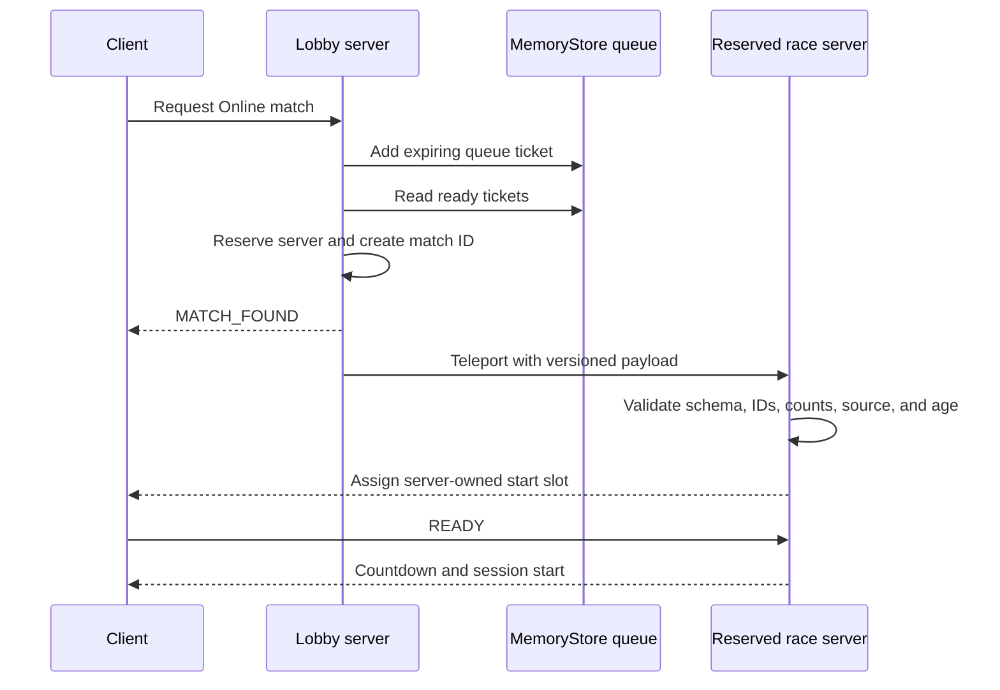

# Architecture

Egg Race separates the public lobby from the race runtime. The lobby owns queue
membership and match formation; the reserved race server owns admission, start
slots, readiness, race state, and results.

## Trust boundaries

- The client may request a mode, cancel, toggle readiness, and observe status.
- The client never supplies rewards, placement, queue size, or a start slot.
- The lobby creates an opaque match ID and the expected user list.
- The race server rejects malformed, stale, duplicate, oversized, or
  wrong-source payloads before admitting a player.
- Studio dry-run mode exercises the flow without issuing a live teleport.

## Why the payload is versioned

The lobby and race are separate Places and can be deployed independently. A
schema version prevents one side from silently interpreting a newer payload
with older assumptions. Count equality and duplicate-ID rejection also keep the
expected-player set internally consistent.

`MatchAdmission` then applies runtime context that cannot be validated by the
parser alone: the expected source Place and the allowed payload age. It returns
an explicit rejection reason without trusting any client-provided state.

## Camera fitting

The ceremony camera does not use one manually tuned position. `CameraFit`
collects visible world-space bounds, projects every corner into a camera basis,
and solves the minimum distance that satisfies the horizontal, vertical, and UI
banner constraints. This keeps the shot stable as viewport aspect ratio,
participant count, and avatar dimensions change.
